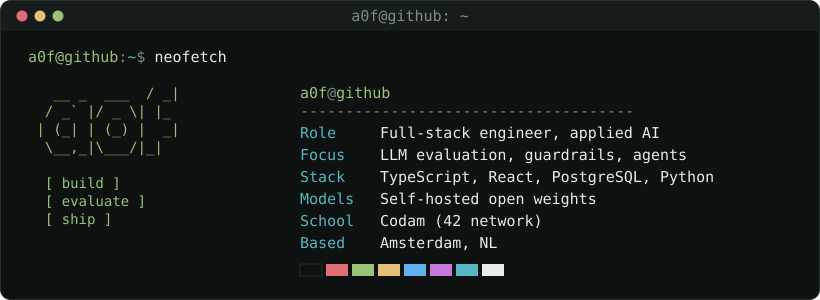

<picture>
  <source media="(prefers-color-scheme: dark)" srcset="card-dark.svg">
  <source media="(prefers-color-scheme: light)" srcset="card-light.svg">
  
</picture>

I build AI features for regulated environments, and the evaluation that shows they work.

Right now I'm the engineer on an LLM-powered analysis platform built for a bank pilot: self-hosted open-weights models, guardrails, and an evaluation harness with calibrated LLM judges. I came into software from psychology through Codam, the 42 coding school in Amsterdam.

### Selected work

- **[minishell](https://github.com/a0f/minishell)**: a bash-like Unix shell in C, with parsing, pipes, redirections and signals. Built with [Matthias](https://github.com/Matthias1590).
- **[webserv](https://github.com/a0f/webserv)**: an HTTP/1.1 server in C++, with config parsing, CGI, cookies and sessions, and non-blocking I/O. Built with [DjaxBank](https://github.com/DjaxBank).
<!-- Add when validated: ft_transcendence (team build, product owner). Add when built: the eval harness. -->

### Stack

TypeScript, React, Node.js, PostgreSQL, Python. LLM evaluation, self-hosted inference, Claude Code agent workflows. C and C++ at Codam.

### Contact

howardtech.sam@gmail.com
